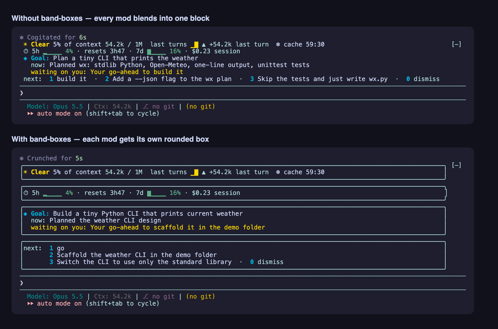

# band-boxes

A Claude Code mod that gives every mod in the band above the prompt its own rounded box.

When several mods draw above the input (context meters, usage, goal recaps, next steps…), they stack into one undivided block and it's hard to tell where one ends and the next begins. band-boxes splits that block back into one layer per mod and draws each in a tight, dim, rounded border. Mods that already draw their own border are left alone.



## Install

At the prompt of a Claude Code terminal session:

```
/plugin install band-boxes --marketplace tsnAnh/band-boxes
```

From a shell:

```
claude plugin install band-boxes --marketplace tsnAnh/band-boxes
```

In the desktop app: click + next to the prompt box, then Plugins, Add marketplace with `tsnAnh/band-boxes`, then Add plugin.

Answer `y` to add the marketplace, pick a scope, and it's active right away. Nothing to configure.

## How it works

Band mods follow one convention: draw their own part and nest everything beneath them (`next(e)`) inside a column. band-boxes walks that nested tree down to Claude Code's own drawing, collects each mod's own part as a layer, strips its side padding, and wraps it in a `round` border.

It only sees the mods that sit beneath it in the render chain. If two mods still share a box, they were stacked above band-boxes.

## Develop

```
claude --plugin-dir ./band-boxes
claude plugin validate ./band-boxes
claude plugin test ./band-boxes
```
